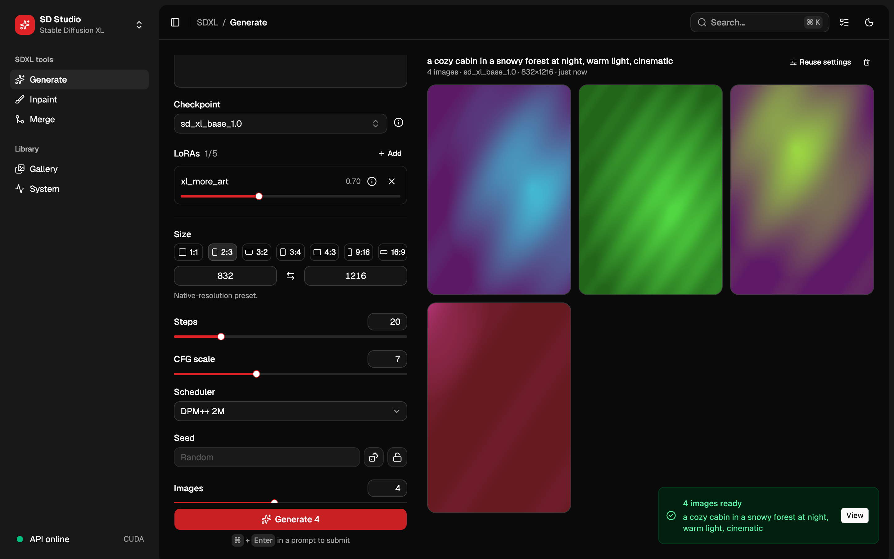

# Stable Diffusion Web App

This is a Stable-Diffusion Web Application written using Streamlit.
Image generation, inpainting and model merging are delegated to the [sd-api-backend](../sd-api-backend) REST service,
so the frontend itself needs no GPU or model files.

To download model checkpoints, have a look at [HuggingFace](https://huggingface.co/models?pipeline_tag=text-to-image&library=safetensors&sort=trending).



## Run Locally

Start the `sd-api-backend` service first (model checkpoints, LoRAs and VAEs live on the backend), then:

```
$ uv run streamlit run main.py
```

The backend URL defaults to `http://localhost:8000`. Override it with the `SD_API_URL` environment variable
(or a `SD_API_URL=` entry in `.env`), or set `api.url` in `parameters.yaml`:

```
$ SD_API_URL=http://gpu-host:8000 uv run streamlit run main.py
```

Generated images are persisted by the backend (`storage.persist_to_backend`); the UI offers PNG and
parameter-JSON downloads for each result. A downloaded JSON can be loaded back to restore generation settings.

## Current supported features

- SD1.5 Inference with optional LoRA support
- SDXL Inference with optional LoRA support
- SD1.5 Model Merging Capabilities
- Support for custom VAEs in both SDXL and SD1.5 inference phases
- SD1.5 and SDXL Inpainting
